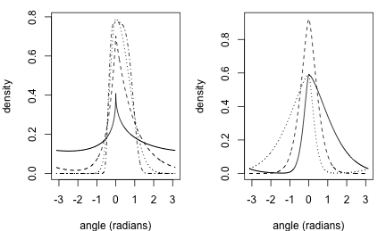
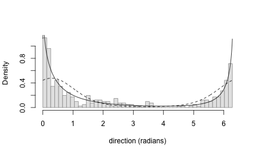

``` r
library(wsgnstat)
```

## Introduction

The two-piece exponential power distribution joins two halves of an exponential power density
with different scales at a location $\mu$. It goes back to the construction of
Fernández and Steel (1998), and it has appeared under several names since. The package name keeps
the authors' earlier one, the (wrapped) skew generalised normal distribution. This vignette treats
the distribution and its wrapped version on the circle as a uniform scale mixture. Section 2 gives
the mixture and checks it by simulation, Section 3 the characteristic function and the
trigonometric moments for small and large shapes, and Section 4 the accuracy of the wrapped
density. Section 5 fits the four-parameter wrapped distribution to wind directions under a lower
bound on the shape, and Section 6 fits rounded data by the grouped likelihood.

## 2. The distribution as a uniform scale mixture

Let $\mu$ be real, $\sigma > 0$, $0 < \lambda < 1$ and $\beta > 0$, and write $a = \lambda/\sigma$
and $b = (1 - \lambda)/\sigma$ for the rates to the right and to the left of $\mu$. Let $Z > 0$
be such that $Z^\beta$ has the gamma distribution with shape $1 + 1/\beta$, let $V$ be uniform on
$[-1/b, 1/a]$, independent of $Z$, and put $X = \mu + ZV$. Given $Z$, $X$ is uniform on the
interval $[\mu - Z/b, \mu + Z/a]$, which contains $\mu$, and $X$ has the density
$$
f(x) = c\exp\{-(a(x - \mu))^\beta\},\quad x \ge \mu, \qquad
f(x) = c\exp\{-(b(\mu - x))^\beta\},\quad x < \mu,
$$
where $c = \lambda(1 - \lambda)/\{\sigma\Gamma(1 + 1/\beta)\}$. The value $\lambda = 1/2$ gives the
symmetric exponential power distribution, $\beta = 2$ with $\lambda = 1/2$ the normal distribution
with standard deviation $\sqrt{2}\sigma$, and $\beta = 1$ the asymmetric Laplace distribution. The
mixture also gives $\mathrm{P}(X < \mu) = \lambda$ and the moments
$\mathrm{E}(X - \mu)^k = \mathrm{E}Z^k\,\mathrm{E}V^k$ without splitting at $\mu$. In the package
the line functions take the right and left rate parameters as `lam1 = lam` and `lam2 = 1 - lam`.

`rsgn()` draws from the mixture with a single uniform variable. A Kolmogorov-Smirnov distance
between $2 \times 10^4$ draws and the closed-form distribution function `psgn()` checks it, at a
shape below one, where the density has a cusp at $\mu$, and at a shape above two.


``` r
set.seed(1)
ks <- function(u) {
  u <- sort(u)
  n <- length(u)
  max(pmax(seq_len(n) / n - u, u - (seq_len(n) - 1) / n))
}
x1 <- rsgn(2e4, mu = 0, sigma = 0.4, beta = 0.3, lam1 = 0.3, lam2 = 0.7)
x2 <- rsgn(2e4, mu = 0, sigma = 1, beta = 2.5, lam1 = 0.7, lam2 = 0.3)
d_ks <- c(ks(psgn(x1, 0, 0.4, 0.3, 0.3, 0.7)), ks(psgn(x2, 0, 1, 2.5, 0.7, 0.3)))
left <- c(mean(x1 < 0), mean(x2 < 0))
mom <- function(k, s, be, l) {
  a <- l / s
  b <- (1 - l) / s
  gamma(1 + (k + 1) / be) / gamma(1 + 1 / be) * (a^-(k + 1) - (-b)^-(k + 1)) /
    ((k + 1) * (1 / a + 1 / b))
}
rbind(KS_distance = d_ks, below_mu = left, lam = c(0.3, 0.7),
      mean = c(mean(x1), mean(x2)), E_X = c(mom(1, 0.4, 0.3, 0.3), mom(1, 1, 2.5, 0.7)))
#>                     [,1]         [,2]
#> KS_distance 5.520403e-03  0.004803465
#> below_mu    3.016000e-01  0.698250000
#> lam         3.000000e-01  0.700000000
#> mean        1.089578e+02 -0.996934233
#> E_X         1.066921e+02 -0.999738911
```

The Kolmogorov-Smirnov distances, 0.0055 and 0.0048, are below the
0.1 per cent critical value 0.0138. The fractions of draws below $\mu$ are
within Monte Carlo error of $\lambda$, and the sample means of the moment formula. The mean of the
heavy-tailed member is noisy, since its variance is large.

The wrapped distribution is that of $\Theta = X \bmod 2\pi$. Given $Z$, $\Theta$ is uniform on an
arc of length $Z(1/a + 1/b)$ that contains $\mu$, and its density is the image sum
$$
g(\theta) = c\sum_{k \ge 0}\left[\exp\{-(a(t + 2\pi k))^\beta\} + \exp\{-(b(2\pi - t + 2\pi k))^\beta\}\right],
\qquad t = (\theta - \mu) \bmod 2\pi .
$$
`dwsgn()`, `pwsgn()`, `qwsgn()` and `rwsgn()` take the four parameters `mu`, `sigma`, `lam` and
`beta`. The four-parameter wrapped distribution is identifiable. When `sigma` is omitted, the
reciprocal-rate subfamily $ab = 1$, that is $\sigma = \{\lambda(1 - \lambda)\}^{1/2}$, is used, as
in version 0.1.0; it is a three-parameter restriction of the model. Figure 1 shows how $\beta$
moves the peak from a cusp to a flat top and how $\lambda$ tilts the mass about $\mu$.


``` r
th <- seq(-pi, pi, length.out = 721)
op <- par(mfrow = c(1, 2), mar = c(4, 4, 1, 1))
dens_b <- vapply(c(0.5, 1, 2, 4), function(b) dwsgn(th, 0, b, 0.3, sigma = 0.3), numeric(721))
matplot(th, dens_b, type = "l", lty = 1:4, col = 1, xlab = "angle (radians)", ylab = "density")
dens_l <- vapply(c(0.2, 0.5, 0.8), function(l) dwsgn(th, 0, 1.5, l, sigma = 0.3), numeric(721))
matplot(th, dens_l, type = "l", lty = 1:3, col = 1, xlab = "angle (radians)", ylab = "density")
```



``` r
par(op)
```

## 3. Characteristic function and trigonometric moments

From the mixture, the characteristic function is
$$
\varphi(t) = \mathrm{e}^{\mathrm{i}t\mu}\,c\left\{\frac{1}{a}G\!\left(\frac{t}{a}\right)
+ \frac{1}{b}\overline{G\!\left(\frac{t}{b}\right)}\right\},\qquad
G(w) = \int_0^\infty \mathrm{e}^{\mathrm{i}wu - u^\beta}\,\mathrm{d}u,
$$
for every $\beta > 0$, and the trigonometric moments of $\Theta$ are $\varphi_p = \varphi(p)$. On the
real axis the integral oscillates, and for small shapes its integrand decays so slowly that it has
to be followed out to $37^{1/\beta}$, about $5 \times 10^{15}$ at $\beta = 0.1$. Version 0.1.0
applied Simpson's rule there, which failed below $\beta = 0.6$. Since $\mathrm{e}^{-u^\beta}$ is
analytic off the negative axis, the path of integration may be turned onto the ray
$u = r\mathrm{e}^{\mathrm{i}\phi}$ for any $0 \le \phi < \min\{\pi, \pi/(2\beta)\}$, along which both
factors decay and the oscillation is slow. With $r = \mathrm{e}^x$ the integrand is analytic in a
strip about the real $x$-axis, so the trapezoid rule converges exponentially as the step is halved,
and `cfsgn()` stops when two successive sums agree to `tol` (default $10^{-12}$). The convergent
series, descending for $\beta < 1$ and ascending for $\beta > 1$, are available as
`method = "series"` for checking.

The characteristic function at zero must be one. Version 0.1.0 returned 40624 at $\beta = 0.1$.


``` r
shapes <- c(0.1, 0.2, 0.3, 0.5, 1, 2, 3)
cf0 <- vapply(shapes, function(b) Mod(cfsgn(0, 0, 0.4, b, 0.3, 0.7) - 1), 0)
setNames(cf0, paste0("beta=", shapes))
#> beta=0.1 beta=0.2 beta=0.3 beta=0.5   beta=1   beta=2   beta=3 
#>        0        0        0        0        0        0        0
```

Below shape one the descending series converges, and it agrees with the rotated-path quadrature at
small and large arguments. At $\beta = 1$ and at $\beta = 2$ with $\lambda = 1/2$ the
characteristic function has the closed forms
$\mathrm{e}^{\mathrm{i}t\mu}ab/\{(a - \mathrm{i}t)(b + \mathrm{i}t)\}$ and
$\exp(\mathrm{i}t\mu - \sigma^2t^2)$.


``` r
tt <- c(0.5, 1, 3, 10, 40)
small <- vapply(c(0.1, 0.3, 0.7), function(b) {
  max(Mod(cfsgn(tt, 0.3, 0.4, b, 0.3, 0.7) - cfsgn(tt, 0.3, 0.4, b, 0.3, 0.7, method = "series")))
}, 0)
#> Warning in cfsgn(tt, 0.3, 0.4, b, 0.3, 0.7, method = "series"): the series
#> cancels beyond the requested precision at some arguments (NaN returned); use
#> the default quadrature there
a <- 0.3 / 0.4
b <- 0.7 / 0.4
laplace <- max(Mod(cfsgn(tt, 0.3, 0.4, 1, 0.3, 0.7) -
                     exp(0.3i * tt) * a * b / ((a - 1i * tt) * (b + 1i * tt))))
normal <- max(Mod(cfsgn(tt, 0.3, 0.4, 2, 0.5, 0.5) - exp(0.3i * tt - 0.16 * tt^2)))
c(series_0.1 = small[1], series_0.3 = small[2], series_0.7 = small[3],
  laplace = laplace, normal = normal)
#>   series_0.1   series_0.3   series_0.7      laplace       normal 
#> 4.322444e-22 4.177767e-17          NaN 1.053250e-15 1.053250e-15
```

The descending series also gives the exact decay of the trigonometric moments. Unless
$\lambda = 1/2$ and $\beta$ is an even integer,
$|\varphi_p| = Cp^{-(1 + \beta)}\{1 + o(1)\}$, with
$C = c\,\Gamma(\beta + 1)\,|a^\beta\mathrm{e}^{\mathrm{i}\pi(\beta + 1)/2} + b^\beta\mathrm{e}^{-\mathrm{i}\pi(\beta + 1)/2}|$,
which `trig_decay()` returns. The decay is set by the singularity of the density at $\mu$, so a
skew member decays like $p^{-(1 + \beta)}$ even at $\beta = 2$.


``` r
p <- c(10, 100, 1000)
ratio <- vapply(c(0.3, 1.5, 2), function(be) {
  tm <- trig_moments(1000, 0, be, 0.3, sigma = 0.4)
  Mod(complex(real = tm$A[p], imaginary = tm$B[p])) * p^(1 + be) / trig_decay(be, 0.3, 0.4)["C"]
}, numeric(3))
dimnames(ratio) <- list(paste0("p=", p), paste0("beta=", c(0.3, 1.5, 2)))
round(ratio, 4)
#>        beta=0.3 beta=1.5 beta=2
#> p=10     0.6269   1.1590 1.3545
#> p=100    0.7913   1.0047 1.0022
#> p=1000   0.8893   1.0001 1.0000
```

The ratio $|\varphi_p|p^{1 + \beta}/C$ tends to one in each column, slowly at $\beta = 0.3$, where the
relative remainder is of order $p^{-\beta}$.

## 4. Accuracy of the wrapped density

For small shapes the terms of the image sum decay very slowly. Version 0.1.0 summed 50 images on
each side and stopped, which left out most of the mass below $\beta = 0.3$. `dwsgn()` now sums
`K` images directly, or fewer when the rest is negligible. The remainder is added by the
Euler-Maclaurin formula, with the exact incomplete-gamma integral and the terms in the first and
third derivatives. Images are added directly until the first omitted term of the formula is
negligible, so the result does not depend on `K`, and the density integrates to one even at
$\beta = 0.05$. The plain sum of 50 images, computed below from the line density, shows the size
of the old truncation error.


``` r
th <- seq(0, 2 * pi, length.out = 25)[-25]
acc <- t(vapply(c(0.05, 0.1, 0.2, 0.3, 0.5, 1, 2), function(be) {
  d50 <- dwsgn(th, 0.7, be, 0.3, K = 50, sigma = 0.4)
  d3 <- dwsgn(th, 0.7, be, 0.3, K = 3, sigma = 0.4)
  plain <- rowSums(matrix(dsgn(outer(th, 2 * pi * (-50:50), "+"), 0.7, 0.4, be, 0.3, 0.7),
                          nrow = length(th)))
  tot <- stats::integrate(dwsgn, 0, 2 * pi, mu = 0.7, beta = be, lam = 0.3, sigma = 0.4,
                          rel.tol = 1e-12, subdivisions = 2000L)$value
  c(beta = be, K3_vs_K50 = max(abs(d3 / d50 - 1)), mass_minus_1 = tot - 1,
    plain50_rel_error = max(abs(plain / d50 - 1)))
}, numeric(4)))
signif(acc, 3)
#>      beta K3_vs_K50 mass_minus_1 plain50_rel_error
#> [1,] 0.05  0.00e+00    -2.89e-15          1.00e+00
#> [2,] 0.10  3.44e-15    -5.73e-14          1.00e+00
#> [3,] 0.20  1.44e-15     4.82e-14          7.88e-01
#> [4,] 0.30  4.44e-16     1.29e-14          1.24e-01
#> [5,] 0.50  4.44e-16    -3.85e-13          2.68e-06
#> [6,] 1.00  0.00e+00    -1.89e-15          8.88e-16
#> [7,] 2.00  0.00e+00     3.55e-15          2.66e-15
```

The package also carries image sums computed independently to 40 digits by mpmath's
Euler-Maclaurin summation, at six angles, two scales and shapes from 0.1 to 2.


``` r
ref <- utils::read.csv(system.file("extdata", "ref_dw.csv", package = "wsgnstat"))
sig <- ifelse(ref$case == 1, 0.4, sqrt(0.21))
d <- mapply(function(th, be, s) dwsgn(th, 0.7, be, 0.3, sigma = s), ref$theta, ref$beta, sig)
signif(tapply(abs(d / ref$dens - 1), ref$beta, max), 2)
#>     0.1     0.2     0.3     0.5       1       2 
#> 1.8e-15 1.8e-15 4.4e-16 6.7e-16 6.7e-16 2.2e-15
```

The largest relative error is 2.2e-15, below $10^{-14}$ on this grid of
six angles, two scales, $\lambda = 0.3$ and shapes 0.1 to 2. `pwsgn()` sums the exact
incomplete-gamma probabilities of the images in the same way, so that `pwsgn(2 * pi)` is one, and
`qwsgn()` inverts it.

## 5. The four-parameter fit with a shape floor


``` r
wind <- as.numeric(dat$wind)
t_wind <- system.time(fit <- fit_wsgn(wind, se = "none"))["elapsed"]
fit
#> Wrapped two-piece exponential power distribution, maximum likelihood  
#> n = 310  log-likelihood = -369.0648  shape floor = 0.1     
#>               mu  sigma    lam  beta
#> estimate 0.01852 0.0847 0.3085 0.571
#> se            NA     NA     NA    NA
#> standard errors: none
```


The data of the circular package `wind` are 310 wind directions recorded at
Col de la Roa in the Italian Alps between 3 and 4 a.m. each day from 29 January to 31 March 2001
(Agostinelli, 2007). Readings 15 minutes apart are dependent, so the fit is descriptive.

With the shape free, the likelihood of the wrapped distribution is unbounded as $\beta$ tends to
zero, with $\mu$ at an observation. At every fixed shape it is bounded, unless all observations
coincide. Under a lower bound $\beta \ge \beta_0$ that does not exceed the true shape, the maximum
likelihood estimator is consistent. `fit_wsgn()` therefore maximises over $\beta_0 \le \beta \le 20$,
by default with $\beta_0 = 0.1$. It searches both the regular branch and the spike branch, at three
shapes, the floor times 1, 1.25 and 1.6, with the location at every observation, and returns the
best; `at_floor`
reports a fit on the floor and `at_rate_bound` a degenerate fit. The fitted shape, 0.57, is well
above the floor.

When the fitted shape is at
most one, the log-likelihood is convex in $\mu$ between consecutive observations, so every
maximising location is an observation. The location is then searched over the stored values near
the fit, and the fitted location is indeed one of the observations
(TRUE). At a fitted shape below one `fit_wsgn()` gives no standard errors
by default, since asymptotic normality is proved only for shapes above one. A parametric bootstrap
is available with `se = "bootstrap"`, each refit repeating both searches and taking as long as the
fit itself (52 seconds here), so it is left out of this vignette.

The profile likelihood $M(\beta)$ shows whether the degenerate branch below the floor comes near
the fit. As $\beta \to 0$ it rises at the leading rate $A^*/\beta$, with
$A^* = n\log\{n/(n - m)\}$ and $m$ the largest number of tied observations.


``` r
pr <- profile_wsgn(wind, beta = c(0.3, unname(coef(fit)["beta"]), 1, 2), window = 0.4)
astar <- n_w * log(n_w / (n_w - m_w))
cbind(pr[, c("beta", "logLik")], A_over_beta = astar / pr$beta)
#>        beta    logLik A_over_beta
#> 1 0.3000000 -378.0811    6.688265
#> 2 0.5710469 -369.0648    3.513686
#> 3 1.0000000 -377.9621    2.006479
#> 4 2.0000000 -411.3535    1.003240
```

Here $m = 2$ and $A^* = 2.01$. The profile has
its maximum at the fitted shape and falls away on both sides; at $\beta = 0.3$ it is already
9.0 below the fitted value. With so small an
$A^*$ the degenerate branch plays no part at the shapes that matter. The profile at shapes near the
floor is slow to compute for these data, since the image sums are long there, and is left out.

The von Mises distribution fitted by `circular::mle.vonmises()` is far behind in log-likelihood and
AIC.


``` r
vm <- circular::mle.vonmises(circular::circular(wind))
ll_vm <- sum(log(circular::dvonmises(circular::circular(wind), vm$mu, vm$kappa)))
data.frame(model = c("wrapped two-piece", "von Mises"), k = c(4, 2),
           logLik = c(fit$logLik, ll_vm), AIC = c(AIC(fit), 4 - 2 * ll_vm))
#>               model k    logLik      AIC
#> 1 wrapped two-piece 4 -369.0648 746.1296
#> 2         von Mises 2 -417.0707 838.1414
```

Figure 2 shows the fit.


``` r
g <- seq(0, 2 * pi, length.out = 721)
hist(wind, breaks = seq(0, 2 * pi, length.out = 49), freq = FALSE, main = "",
     xlab = "direction (radians)", col = "grey90", border = "grey60")
lines(g, dwsgn(g, coef(fit)["mu"], coef(fit)["beta"], coef(fit)["lam"], sigma = coef(fit)["sigma"]))
lines(g, circular::dvonmises(circular::circular(g), vm$mu, vm$kappa), lty = 2)
```



For a fitted shape clearly above one, `fit_wsgn()` gives standard errors from the expected Fisher
information $I(\hat\vartheta)^{-1}/n$, which is finite for $\beta > 1/2$. A simulated sample shows
this route.


``` r
set.seed(2)
sim <- rwsgn(150, mu = 1, beta = 1.8, lam = 0.3, sigma = 0.5)
fit_sim <- fit_wsgn(sim)
round(rbind(truth = c(1, 0.5, 0.3, 1.8), estimate = coef(fit_sim), se = fit_sim$se), 3)
#>             mu sigma   lam  beta
#> truth    1.000 0.500 0.300 1.800
#> estimate 1.313 0.553 0.412 1.486
#> se       0.169 0.092 0.065 0.281
```

### Speed

A fit is a search from many starting values, a screen of candidate locations and, for the
smallest shapes, a spike search, and these trials are independent of one another. Where the
package is built with OpenMP, `ncores` runs them on several threads, and `profile_wsgn()` takes
the same argument. The best trial is chosen afterwards in a fixed order, so the answer is
identical, to the last bit, for every number of threads; `ncores = 1` is the default. A bootstrap
spreads its refits over the threads instead.


``` r
sim40 <- sim[1:40]
f_serial <- fit_wsgn(sim40, se = "none")
f_two <- fit_wsgn(sim40, se = "none", ncores = 2)
identical(coef(f_serial), coef(f_two))
#> [1] TRUE
```

A fit takes minutes from about a thousand observations on, so threads pay there. A likelihood evaluation with 128 or more observations (or cells) is itself split over the threads and summed in a fixed order. On a laptop with four performance and six efficiency cores, busy with other work, a fit of 1500 observations took 160 seconds on one thread, 86 on two, 57 on four and 55 on eight, and one of 400 observations 36, 18, 11 and 13 seconds. That is a factor of about 2.8 on four threads, and little more beyond, because some of the work still runs in sequence (the first pass of the location search, the Nelder-Mead runs and the final polish) and because the extra threads of such a machine run on its slower cores.

## 6. The grouped likelihood for rounded data

Circular data are usually recorded to a resolution, and ties then make the degenerate branch
visible at shapes that look ordinary. The ants of Fisher (1993, data set B.7, `fisherB7` in
circular) are 100 directions recorded as multiples of 10 degrees.


``` r
ants <- as.numeric(dat$fisherB7) * pi / 180
m_a <- max(table(dat$fisherB7))
astar_a <- 100 * log(100 / (100 - m_a))
pa <- profile_wsgn(ants, beta = c(2, 1, 0.5, 0.2, 0.05), window = 0.4)
pa$mu_degrees <- pa$mu * 180 / pi
pa[, c("beta", "logLik", "mu_degrees")]
#>   beta     logLik mu_degrees
#> 1 2.00 -147.79796   193.2992
#> 2 1.00 -135.41341   200.0000
#> 3 0.50 -125.09101   180.0000
#> 4 0.20  -91.24055   180.0000
#> 5 0.05  143.17113   180.0000
```

There are $m = 17$ ants at 180 degrees, so $A^* = 18.63$,
and the profile rises monotonically as the shape decreases, with the location at the tied value.
Any lower bound on $\beta$ would be attained. When the data are rounded, the grouped likelihood
$\sum_j N_j\log\mathrm{P}(\Theta \in C_j)$ over the recording cells is the likelihood of what was
observed. It is bounded with no constraint on the shape, and its cell probabilities follow exactly
from the incomplete-gamma survival functions of the two sides. `fit_wsgn()` maximises it when
`resolution` is given.


``` r
set.seed(4)
fit_g <- fit_wsgn(ants, resolution = pi / 18, se = "bootstrap", B = 10, ncores = 2)
fit_g
#> Wrapped two-piece exponential power distribution, maximum likelihood (grouped) 
#> n = 100  log-likelihood = -306.9329  shape floor = 0.001     
#>               mu   sigma     lam   beta
#> estimate 3.19200 0.08321 0.48180 0.5086
#> se       0.06337 0.05319 0.06574 0.0951
#> standard errors: bootstrap
coef(fit_g)["mu"] * 180 / pi
#>       mu 
#> 182.8971
```


The grouped maximum is interior, at $\hat\beta = 0.51$
with the location at 182.9 degrees, and the
17 values at 180 degrees are simply a well-filled cell. As the shape tends to
zero the family approaches mixtures of a point mass and the uniform distribution, and the best such
mixture with its point mass in the modal cell reaches a grouped log-likelihood of
-340.68, against -306.93 at the fit. The grouped likelihood-ratio statistic for
$\lambda = 1/2$ is 0.05, so these data show
no evidence of skewness. Each bootstrap sample is rounded to the same cells before it is refitted.

## Conclusion

The two-piece exponential power distribution and its wrapped version were treated as a uniform
scale mixture with generalised gamma mixing, and the mixture was checked by simulation. The
characteristic function and the trigonometric moments were computed on a rotated path of
integration for every shape, and checked against the convergent series and the closed
forms at shapes one and two, and the decay constant of the trigonometric moments was confirmed.
The wrapped density, with its Euler-Maclaurin tail, integrated to one at every shape tried.

The four-parameter distribution was fitted to the Col de la Roa wind directions under a shape floor,
with the location at an observation, and the profile likelihood showed the degenerate branch far
below the floor. For the rounded ant directions the ordinary likelihood had no maximum, while the
grouped likelihood gave an interior fit. The distribution has also been fitted to daily wind
directions from the Namib Desert (SASSCAL WeatherNet). Their licence allows non-commercial use
only, so they are not distributed with the package.


The computations of this vignette took 133 seconds.

## References

Agostinelli, C. (2007). Robust estimation for circular data. *Computational Statistics and Data
Analysis*, 51(12), 5867-5875.

Fernández, C. and Steel, M. F. J. (1998). On Bayesian modeling of fat tails and skewness. *Journal
of the American Statistical Association*, 93(441), 359-371.

Fisher, N. I. (1993). *Statistical Analysis of Circular Data*. Cambridge University Press,
Cambridge.
